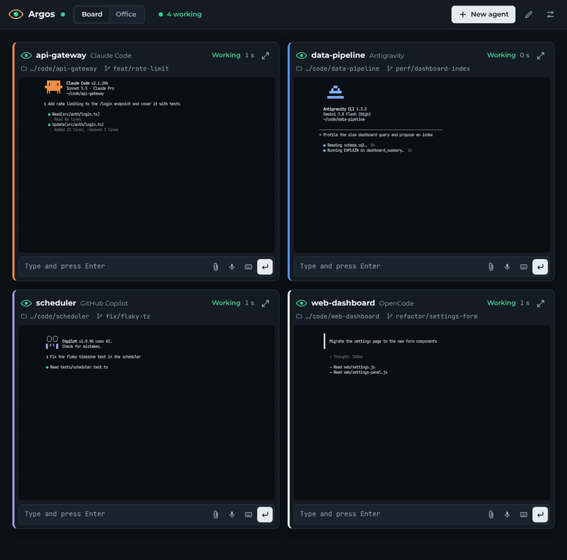
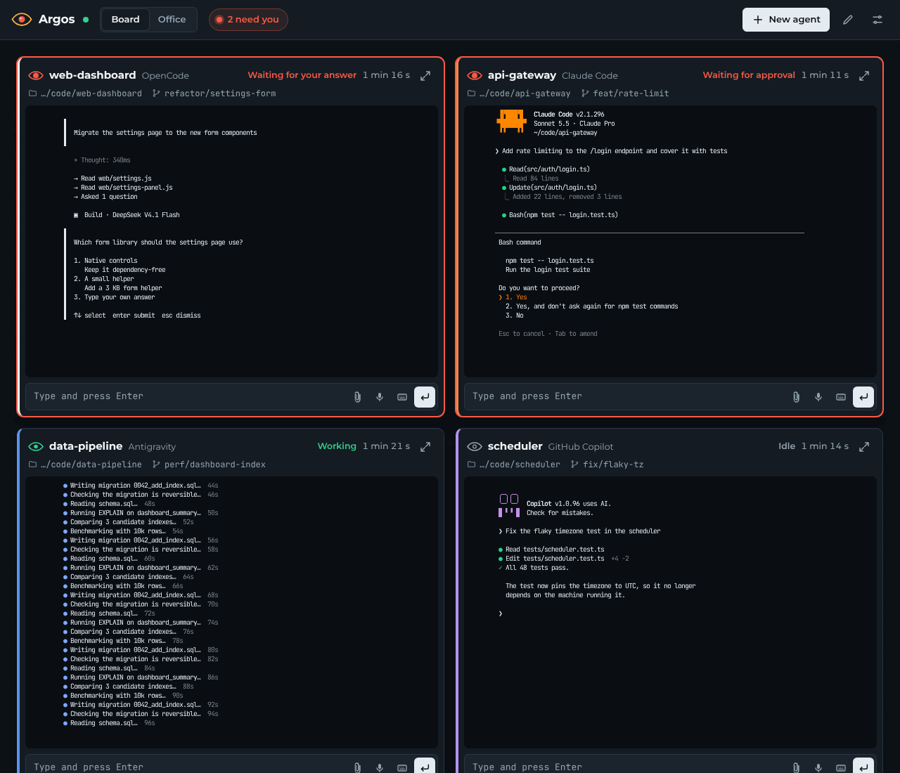
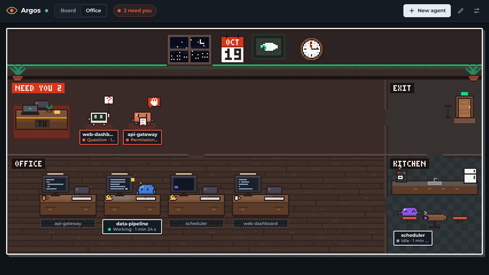
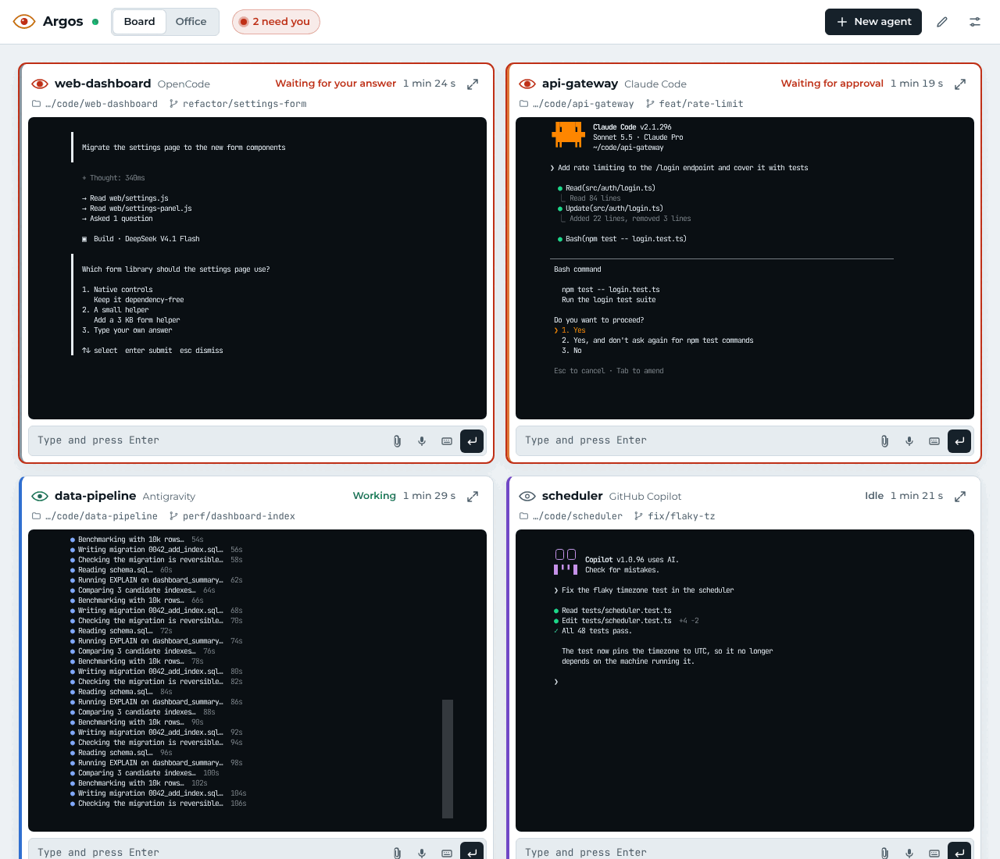
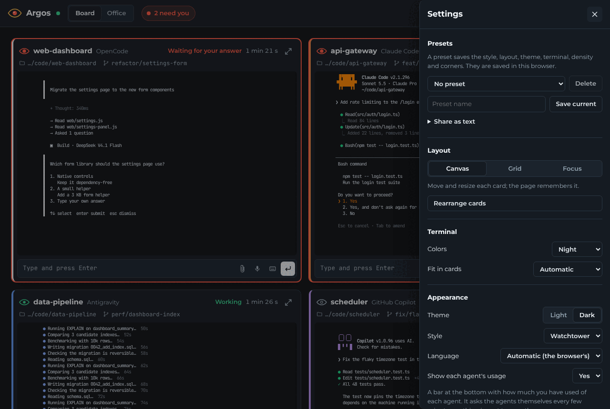
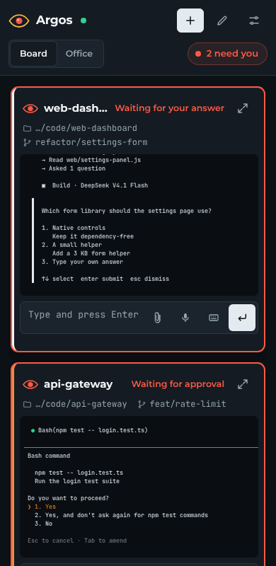

<div align="center">

# 👁 argos-board

**A local web board that shows what all your CLI coding agents are doing — and tells you the moment one needs you.**

[English](README.md) · [Español](README.es.md) · [Privacy](PRIVACY.en.md) · [Changelog](CHANGELOG.md)



</div>

Running `claude`, `opencode`, `agy` or `copilot` in several terminals means constantly alt-tabbing to check which one
finished, which one is stuck on a permission prompt and which one asked you a question. Argos Board puts them all on
one page, live, and flags the ones that are waiting for you.

- **Live state per agent**: working, idle, waiting for your answer, waiting for approval, error, finished.
- **A faithful terminal in every card**, drawn cell by cell with xterm.js — not a text summary.
- **Answer from the page**, or from your phone: type, send keys, attach files, dictate by voice.
- **Alerts** when an agent starts waiting (tab counter, browser notification, optional sound).
- **Usage bar** with how much of each agent's quota you have spent.
- **Local and private**: no accounts, no telemetry, no outbound calls of its own. [Details](PRIVACY.en.md).
- A single binary with the web page embedded. Works with any command, with calibrated detection for the four above.

## Install

Linux and WSL2 (x86_64 and aarch64). Download the latest binary from the
[releases page](https://github.com/nomekogenkah/argos-board/releases/latest):

```sh
curl -L https://github.com/nomekogenkah/argos-board/releases/latest/download/argos-board-x86_64-unknown-linux-gnu.tar.gz | tar xz
sudo install argos-board-*/argos-board /usr/local/bin/
```

Use `aarch64-unknown-linux-gnu` instead on ARM. Each release ships a `SHA256SUMS` file. Or build it yourself with
Rust (stable):

```sh
cargo install --git https://github.com/nomekogenkah/argos-board
```

> macOS and native Windows are not supported yet. On Windows, run it inside WSL2 and open
> `http://localhost:8787` from your Windows browser.

## Use

```sh
argos-board serve                          # once; prints the link to open (http://localhost:8787/#k=…)
argos-board run -- claude                  # one per terminal, wrapping the agent
argos-board run --name backend -- opencode
```

The wrapper is transparent: the agent behaves exactly as without it, and keeps working if the server is not running.
Open the link `serve` prints: with it the page can also write to the agents; without the token it is read-only.
You can also launch agents from the page (**New agent**).

## The page

| Board | Office |
|---|---|
|  |  |

- **Board** with three layouts (free canvas, grid, focus), eight styles (four looks, light and dark), presets and
  English / Spanish.
- **Office**: the same information as a pixel-art floor plan. Where an agent sits tells you its state: at your desk
  queue if it needs you, at its desk if it works, in the kitchen if it is idle.
- **Mobile friendly**: pair your phone with a one-time code and watch or answer your agents from the couch
  (`argos-board pair`).
- **Accessible**: axe-core clean (WCAG 2.1 AA) in every style, keyboard navigation, reduced motion.

<details>
<summary>More screenshots</summary>






</details>

## Agent states

| State | Meaning |
|---|---|
| `working` / `idle` | Detected from changes on the agent's screen |
| `waiting_input` | The agent asked you a question (calibrated for `claude`, `opencode`, `agy`, `copilot`) |
| `waiting_approval` | It asks for permission (calibrated for `claude`, `copilot`) |
| `error` | Reserved: no patterns calibrated yet |
| `exited` / `disconnected` | The agent ended / lost its server |

The detection patterns per agent are plain regular expressions in [`src/profiles.toml`](src/profiles.toml) and can be
overridden in `~/.config/argos-board/config.toml` — see the [reference guide](docs/guide.es.md#perfiles-de-detección).

## Security

The server listens on `127.0.0.1` and on the machine's private networks (use `--local-only` to restrict it). Writing
to agents requires a control token that only works from the machine itself; other devices need a one-time pairing
code and get their own revocable token. Agent output is never written to disk and screen lines are redacted for
secrets before leaving the wrapper. Traffic is plain HTTP, so use trusted networks or an encrypted tunnel
(WireGuard, Tailscale) and do not put a reverse proxy in front. Read the [privacy policy](PRIVACY.en.md).

## Documentation

- [Reference guide](docs/guide.es.md) (Spanish): every feature, detection profiles, calibration, network access,
  environment variables, wrapper behaviour.
- [Specification](docs/argos-board-spec.md) (Spanish) and the [changelog](CHANGELOG.md).

## Development

```sh
cargo test
cargo clippy --all-targets -- -D warnings
cargo fmt --check
node --test tests/web/*.test.mjs     # page logic that needs no browser
```

- `src/server/` — `serve`: axum, in-memory state, WebSockets `/ws` (browser) and `/ingest` (wrapper), usage probes.
- `src/wrapper/` — `run`: PTY, raw mode, `vt100` emulator, activity detection, ingest client.
- `src/model.rs` — agent snapshot and messages (the stable contract, see the spec §4).
- `web/` — the page, embedded in the binary: plain HTML, CSS and JS with no build step.

Releases are cut by pushing a `vX.Y.Z` tag; see [`.github/workflows/release.yml`](.github/workflows/release.yml).

## License

[MIT](LICENSE). Vendored libraries (gridstack.js, xterm.js) and fonts (Montserrat, JetBrains Mono — OFL) keep their
own licenses, next to their files.
